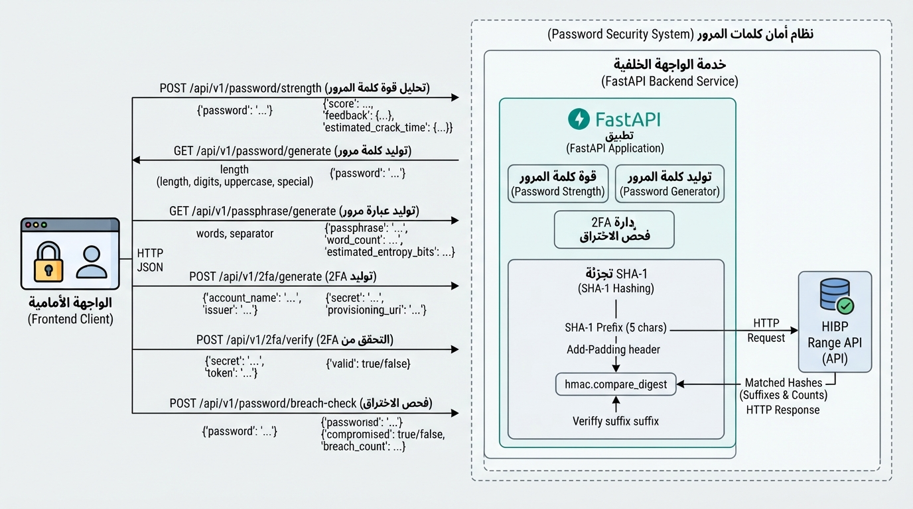

# Password Security API

A FastAPI service that provides password strength analysis, secure password and passphrase generation, TOTP enrollment/verification, and a privacy-preserving Have I Been Pwned (HIBP) password check.

## Architecture



## Requirements

- Python 3.10+
- Network access to `api.pwnedpasswords.com` for breach checks.

## Run Locally

### 1. Create a virtual environment

```powershell
py -m venv .venv
```

### 2. Activate the virtual environment

```powershell
.\.venv\Scripts\Activate.ps1
```

### 3. Install dependencies

```powershell
python -m pip install -r requirements.txt
```

### 4. Start the API server

```powershell
uvicorn app.main:app --host 127.0.0.1 --port 8000
```

Interactive API documentation is available at:

[http://127.0.0.1:8000/docs](http://127.0.0.1:8000/docs)

For deployment, run behind a TLS-terminating reverse proxy and configure the proxy, process manager, and network policy for your environment.

The service does not log request passwords.

The breach-check endpoint has a five-second upstream timeout. The following environment variables can override the default configuration:

- `HIBP_TIMEOUT_SECONDS`
- `HIBP_RANGE_URL`

## API Endpoints

### 1. Password Strength Analysis

**POST** `/api/v1/password/strength`

Accepts a password and returns:

- zxcvbn strength score.
- Warning messages.
- Improvement suggestions.
- Estimated password cracking times.

Example request:

```json
{
  "password": "ExamplePassword123!"
}
```

### 2. Secure Password Generation

**GET** `/api/v1/password/generate`

Generates a cryptographically secure random password.

Available parameters:

- `length`: Password length (8–128).
- `digits`: Include numbers.
- `uppercase`: Include uppercase letters.
- `special`: Include special characters.

Example:

`/api/v1/password/generate?length=20&digits=true&uppercase=true&special=true`

Lowercase characters are always available, and every enabled character class is guaranteed to appear.

### 3. Text-Based Passphrase Generation

**POST** `/api/v1/passphrase/generate-from-description`

Generates secure passphrases based on user-provided text descriptions.

Example request:

```json
{
  "description": "My favorite programming language is Python",
  "length": 8,
  "separator": "-"
}
```

Parameters:

- `description`: 1–300 characters.
- `length`: 6–16 tokens (default: 8).
- `separator`: 1–8 characters.

Unique alphanumeric tokens are hardened with CSPRNG-driven casing and in-place digit/symbol substitutions. Unique variants are added when the description does not contain enough tokens.

### 4. TOTP Secret Generation

**POST** `/api/v1/2fa/generate`

Accepts:

- `account_name`
- `issuer` (optional)

Returns a Base32 TOTP secret and an `otpauth://` provisioning URI.

Deliver and store this secret securely.

### 5. TOTP Verification

**POST** `/api/v1/2fa/verify`

Accepts:

- `secret`: Base32 TOTP secret.
- `token`: Six-digit authentication token.

Validates the token against the current 30-second TOTP interval.

### 6. Password Breach Check

**POST** `/api/v1/password/breach-check`

Checks whether a password has appeared in known data breaches using the Have I Been Pwned (HIBP) API.

Example request:

```json
{
  "password": "ExamplePassword123!"
}
```

The HIBP endpoint:

1. Hashes the password locally using SHA-1.
2. Sends only the first five hexadecimal hash characters to HIBP.
3. Receives matching hash suffixes.
4. Performs the suffix comparison locally.
5. Returns whether the password was found and its occurrence count.

It uses the HIBP `Add-Padding` response header to reduce response-size leakage.

## Security Considerations

- The service does not log request passwords.
- Password breach checks use the HIBP k-Anonymity model.
- Password generation uses cryptographically secure randomness.
- TOTP secrets must be delivered and stored securely.
- CORS accepts any origin without credentials by default. Restrict origins at deployment time if required.
- Production deployments should use HTTPS behind a TLS-terminating reverse proxy.

## Tests

Run the test suite using:

```powershell
python -m pytest
```

## Project

**Vaultline - Password Security API**

A project focused on password security, secure authentication, and user privacy.
